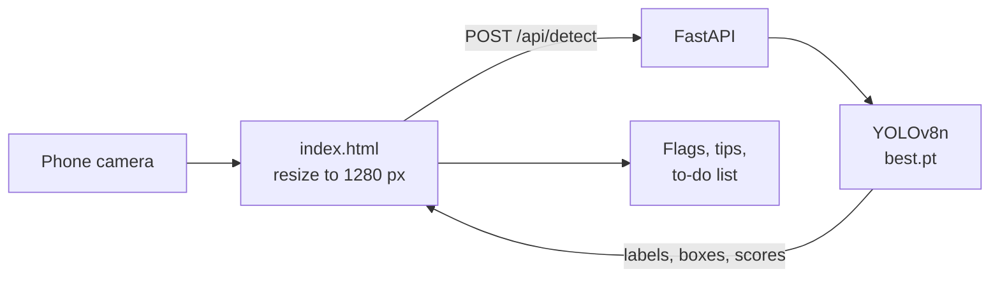

# Backyard Sweep

*Turn the weekly "check for standing water" chore into a short, guided walk.*


**Live demo:** https://mosquito-breeding-detector.onrender.com
(Free server: the first load after a quiet spell can take up to a minute.)

Photograph anything around your home that could hold water. A YOLOv8 detector flags the containers that commonly breed mosquitoes, and each one comes with a plain-language tip for what to do about it.

Built for the Hacktoberfest 2026 Open-Source AI Challenge, Week 1: **Touch Grass**.

<!-- Add a screenshot or GIF here once you have one:

-->

## Contents

1. [Why this exists](#why-this-exists)
2. [Features](#features)
3. [How it works](#how-it-works)
4. [Model and results](#model-and-results)
5. [API](#api)
6. [Why open source mattered](#why-open-source-mattered)
7. [Run it locally](#run-it-locally)
8. [Deploy on Render](#deploy-on-render)
9. [Project structure](#project-structure)
10. [Limits and responsible use](#limits-and-responsible-use)
11. [Ideas for next steps](#ideas-for-next-steps)
12. [Credits and licence](#credits-and-licence)

## Why this exists

Dengue is spread by *Aedes* mosquitoes, which breed in small containers of standing water: tires, vases, bottles, coconut shells, blocked drains. Health agencies advise emptying, scrubbing or covering these regularly. The hard part is not knowing what to do. It is noticing the containers you have stopped seeing.

Backyard Sweep turns that into a walk. You go outside, photograph what could hold water, and get a short to-do list with a tip for each spot.

## Features

- **Camera first.** On a phone, "Take a photo" opens the camera directly.
- **Survey-flag boxes** drawn on your photo, with a tip for every container type.
- **Confidence slider** that filters results instantly, with no re-scan.
- **Copy to-do list** for the spots on screen.
- **Walk tracker:** five photos make a proper sweep.
- **Go-outside check:** an optional, rule-based nudge from live weather (Open-Meteo), including whether recent rain may have refilled containers. It runs only when you tap it.
- Light mode and a dark "night forest" mode, keyboard accessible, respects reduced motion.
- Friendly loading, empty and error states. No build step, no framework.

## How it works



The page shrinks the photo, sends it to `POST /api/detect`, and draws the returned boxes on a canvas. The server reads the photo in memory, runs the model, and returns JSON. It does not write photos to disk.

## Model and results

YOLOv8n, trained for 30 epochs at 640 px on the **Breeding Place Detection** part of the VisText-Mosquito dataset (1,828 images, five classes). Evaluated on the dataset's held-out test split: 183 images, 424 objects.

| Class | Test instances | AP50 |
|---|---:|---:|
| Bottle | 50 | 0.884 |
| Coconut-Exocarp | 101 | 0.973 |
| Drain-Inlet | 54 | 0.956 |
| Tire | 115 | 0.893 |
| Vase | 104 | 0.923 |
| **All** | **424** | **0.926** (mAP50) |

Precision 0.906, recall 0.844, mAP50-95 0.692.

**Read these numbers carefully.** The test photos come from the same collection as the training photos (daylight scenes from Bangladesh). They show the model works on that kind of image. They do not guarantee the same accuracy on every home, street or camera. Confidence scores are not calibrated probabilities, and crowded scenes with many similar objects can score lower.

<!-- FIELD TEST: after your walk, delete this comment marker and fill in your own numbers.

### Field test on real homes

| Photos | Containers present | Found | Missed | False alarms |
|---:|---:|---:|---:|---:|
| 0 | 0 | 0 | 0 | 0 |

What it got wrong, and what I would change:
-
-->

## API

`POST /api/detect` with `multipart/form-data`:

| Field | Type | Notes |
|---|---|---|
| `file` | image | JPG or PNG, up to 15 MB. Resized to fit 1280 px. |
| `conf` | float | Minimum confidence, default `0.10`, clamped to 0.05 to 0.95. |

Example response shape (values are illustrative):

```json
{
  "width": 960,
  "height": 1280,
  "detections": [
    { "label": "Tire", "conf": 0.91, "box": [0.12, 0.40, 0.55, 0.88] }
  ]
}
```

`box` is `[x1, y1, x2, y2]`, normalised to 0 to 1 so it can be drawn at any size. `GET /health` returns `{"ok": true}`.

## Why open source mattered

- **A small model for one job.** YOLOv8n is trained on exactly five container types and runs on a free CPU instance. There is no per-photo API fee.
- **You control where photos go.** Detection happens in a server you run, not in a third-party AI service. Self-hosting is one command (below). Detection needs no internet once installed. Only the optional weather card and web fonts call out.
- **Swappable.** Replace `best.pt` with a retrained model and the app keeps working, because the contract is just labels, scores and boxes.
- **Inspectable.** Code, weights, dataset and licences are all public, so every claim in this README can be checked.
- **The trade-off.** Ultralytics YOLO is AGPL-3.0, so this project is released under AGPL-3.0 too.

## Run it locally

```bash
git clone https://github.com/KK-Dev0/mosquito-breeding-detector.git
cd mosquito-breeding-detector
pip install -r requirements.txt
uvicorn app:app --port 8000
```

Open http://localhost:8000. Make sure `best.pt` sits next to `app.py`.

## Deploy on Render

| Setting | Value |
|---|---|
| Build command | `pip install -r requirements.txt` |
| Start command | `uvicorn app:app --host 0.0.0.0 --port $PORT` |
| Environment variable | `PYTHON_VERSION` = `3.11.9` |

The free plan has 512 MB of memory, which is tight for PyTorch plus a model. If the service restarts during a scan, check the logs for an out-of-memory message.

## Project structure

```
app.py             FastAPI server: POST /api/detect, GET /health, serves the page
index.html         The whole frontend (HTML, CSS, vanilla JS), no build step
best.pt            Trained YOLOv8n weights
requirements.txt   CPU-only PyTorch, Ultralytics, FastAPI, Pillow
LICENSE            AGPL-3.0
```

## Limits and responsible use

- It finds **containers that can hold water**. It cannot tell whether there is water inside, so look in each one.
- It knows five container types. Buckets, water drums, pot saucers and many other breeding sites are not in the training data.
- It is not a medical tool. It does not diagnose, treat or prevent dengue. Follow your local health department's guidance.
- Tips are general advice about emptying, scrubbing, covering and binning containers.

## Ideas for next steps

- Classify **water present or absent** using the dataset's water-segmentation subset.
- Add classes for buckets and water drums, with new labelled photos.
- Tune the default confidence threshold from the validation F1 curve.
- Test and report accuracy on photos from Indian homes.

## Credits and licence
- **Dataset:** Faiyaz, Md Faiyaz Abdullah Sayeedi; Jisan, Md Adnanul (2025). *VisText-Mosquito: A Multimodal Dataset for Mosquito Breeding Site Detection, Surface Segmentation, and Reasoning*. Mendeley Data, V3. DOI [10.17632/rtsfh7jh7p.3](https://doi.org/10.17632/rtsfh7jh7p.3). Licensed [CC BY 4.0](https://creativecommons.org/licenses/by/4.0/).
- **Model code:** [Ultralytics YOLOv8](https://github.com/ultralytics/ultralytics), AGPL-3.0.
- **Weather:** [Open-Meteo](https://open-meteo.com/), used only by the optional go-outside check.
- **This project:** released under AGPL-3.0. See `LICENSE`.

Built by **Kaushikee Karmakar**, BCA, Asansol Engineering College. GitHub: [@KK-Dev0](https://github.com/KK-Dev0).
